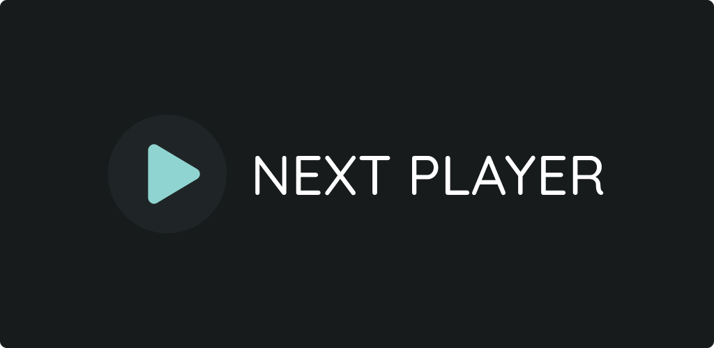

# Next Player (Latest Edition - KennyPhan123 Enhanced)

An advanced, feature-rich Android native video player with expressive Material 3 UI, based on upstream [Next Player](https://github.com/anilbeesetti/nextplayer).

This edition combines upstream's modern architecture and UI improvements with custom cinematic enhancements: Dolby Vision fallback, Kodi-grade audio processing, independent aspect ratio zoom, and bitmap subtitle pinning.

---

## Key Features and Enhancements

### 1. Kodi ActiveAE Audio Engine and Anti-Clipping Peak Limiter
- **32-bit Float Internal Pipeline**: Decodes and mixes audio with full 32-bit float headroom (`C.ENCODING_PCM_FLOAT`). Eliminates harsh 16-bit clipping on high-dynamic-range theatrical tracks (TrueHD, DTS-HD MA, Dolby Atmos, E-AC3).
- **Kodi `CAELimiter` DSP Port**: Genuine instant attack (0 ms), 25 ms hold, and 100 ms exponential release limiter. Allows distortion-free volume boosting up to 200% (+20 dB) without pumping or speaker damage.
- **Smart Stereo Downmix (5.1 / 7.1 -> 2.0)**:
  - *Unnormalized Downmix*: Maintains full theatrical dialogue and effect presence instead of scaling volume down.
  - *Dialogue Clarity Boost*: Accentuates center channel speech (`FC = 0.85f`).
  - *Route-Aware LFE*: Automatically cuts sub-bass (0.0f) on internal phone speakers to prevent cone rattle, while maintaining 35% sub-bass on headphones.

---

### 2. Dolby Vision Profile 7 (DV7) HDR10 Fallback
- Strips incompatible DV7 metadata to smoothly fall back to HDR10 on devices (such as Exynos and various MediaTek chipsets) that otherwise produce black screens.
- Toggle in **Settings -> Player -> Dolby Vision Profile 7 Fallback**.

---

### 3. Independent X / Y Zoom and Axis Snapping
- Pinch to zoom or stretch video along horizontal (X) and vertical (Y) axes independently to fit ultra-wide (21:9) or custom aspect ratio displays.
- Built-in axis snapping prevents unintended diagonal stretching. Custom zoom states persist automatically per video.

---

### 4. Subtitle Enhancements and PGS Fixes
- **PGS Subtitle Aspect Ratio Protection**: Bitmap subtitles (PGS, DVB) retain correct aspect ratios even when non-standard video zoom/stretching is active.
- **Pin Subtitles to Video Surface (`subtitlePinToVideo`)**: Anchors subtitles to the video surface so they follow zoom and pan gestures seamlessly.

---

### 5. PiP Fixes and Modern Controls
- Allows manual Picture-in-Picture entry even when playback is paused.
- Expressive Material 3 interface with customizable control button placement and gesture sensitivity.

---

## Downloads

Download prebuilt APKs from the [Releases](https://github.com/KennyPhan123/nextplayer/releases) tab:
- **`NextPlayer-latest-universal.apk`**: Release package for all Android devices.

---

## License

Next Player is licensed under the [GNU General Public License v3.0](LICENSE).
